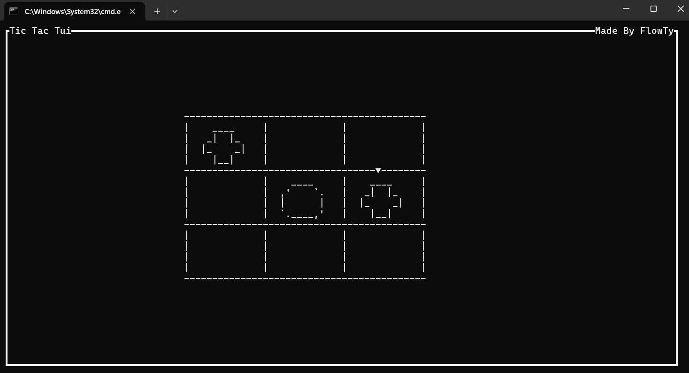

# Tic Tac Tui

Tic Tac Tui is a really simple Tic Tac Toe game in the terminal.

[](TicTacTuiVisual.png)


## why I made it
I built it to start learning `Rust`, and it give me the opportunity to work with TUI (terminal user interface) with `ratatui`, a library for TUIs.

## how to use

```sh
cargo run --release
```
##

[](https://ratatui.rs/)